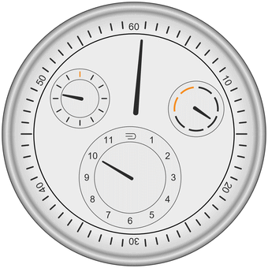

# RessenWatch

A light-dial Ressence Type 1–style watch face in Wolfram Language, built from `ClockGauge` sub-dials that orbit like planetary gears. Hands are slightly tapered, and a thin black line separates the fixed minute ring from the rotating disc.



## How it works

Ressence watches use the ROCS (Ressence Orbital Convex System): there are no central hands, and the whole dial is the display.

- **Carrier disc:** the main disc turns clockwise once per hour. The long marker on it reads the minutes against the outer 10…60 scale, which is fixed to the case.
- **Satellites:** the hour, seconds and day-of-week dials are `ClockGauge` objects mounted on the disc. They orbit with it, but they're counter-geared so the rings never spin: numerals and ticks stay upright, and only the hand inside each one turns.
- **Day dial:** 7 slots for Monday–Sunday, clockwise from 12 o'clock. The hand moves through the current day's slot over the day.

## Usage

```wl
Get["RessenceWatch.wl"]

ressenceFace[{10, 10.5, 47, 3}]   (* {hour, minute, second, ISO weekday} *)
ressenceFace[Now]                 (* a DateObject also works *)
ressenceWatch[]                   (* live watch with a time-warp slider; needs a notebook front end *)
```

Or open `RessenceWatch.nb`, which loads the package and runs the examples.

## Files

| File | Contents |
| --- | --- |
| `RessenceWatch.wl` | The package: `ressenceFace` and `ressenceWatch` |
| `RessenceWatch.nb` | Notebook with the live watch, a still frame and an animation |
| `ressence_rocs.gif` | One hour compressed into a loop |
| `ressence_face.png` | Still frame |

Inspired by the Ressence Type 1. This is an unofficial fan project, not affiliated with Ressence.
