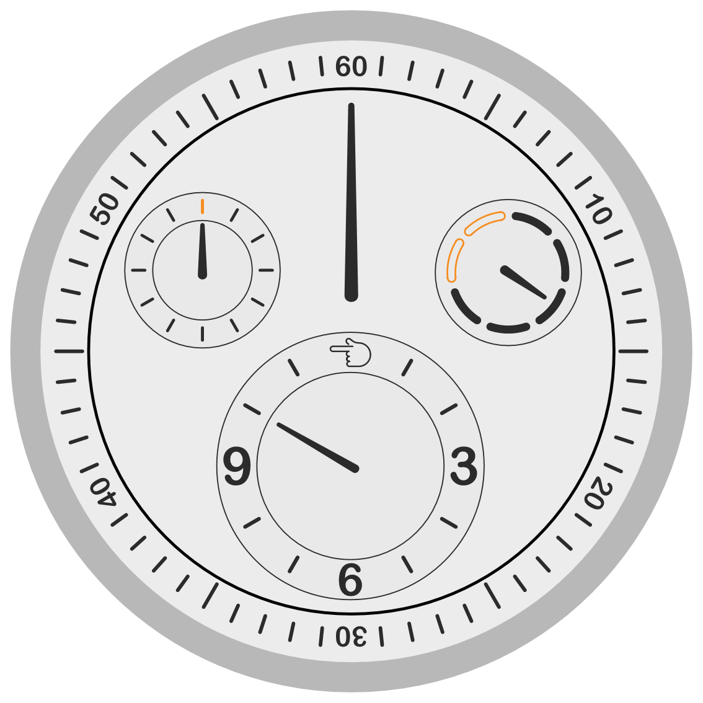

# RessenceWatch

<p align="center">
  <picture>
    <source media="(prefers-color-scheme: dark)" srcset="img/ressence_rocs_black.gif">
    <source media="(prefers-color-scheme: light)" srcset="img/ressence_rocs.gif">
    
  </picture>
</p>

A Ressence Type 1–style watch face in Wolfram Language. Everything is drawn with vector graphics primitives, numerals included (as glyph outlines), and the sub-dials orbit like planetary gears. The animation above follows your GitHub or browser theme: a black dial in dark mode, a pale dial in light mode.

## How the watch works

Ressence watches use the ROCS (Ressence Orbital Convex System). There are no central hands; the whole dial is the display.

- **Carrier disc:** the main disc turns clockwise once per hour. The long marker printed on it reads the minutes against the outer 10…60 scale, which is fixed to the case.
- **Satellites:** the hour, seconds and day-of-week dials are mounted on the disc and orbit with it. They are counter-geared so their rings never spin: numerals and ticks stay upright, and only the hand inside each one turns.
- **Hour dial:** numerals at 3, 6 and 9, short bars at the other hours and the OpenMoji 👈 at 12.
- **Seconds dial:** 12 ticks, with the one at 12 in the accent colour.
- **Day dial:** one short tube per day, clockwise from 12 o'clock: solid for Monday–Friday, hollow in the accent colour for Saturday–Sunday. The hand moves through the current day's arc over the day.

### Colours

The palette uses `LightDarkSwitched`, so the face follows the notebook theme. A light-mode notebook shows the black dial with white markings and green lume; a dark-mode notebook shows the pale dial with orange accents.

## Loading the package

Clone the repository, then load the package file:

```wl
Get["/path/to/RessenceWatch/src/RessenceWatch.wl"]
```

Or open `src/RessenceWatch.nb`, which loads the package from its own folder and runs the examples.

## Functions

```wl
RessenceWatchFace[]                                      (* the face for the current time *)
RessenceWatchFace[DateObject[{2026, 10, 14, 10, 10, 47}]]  (* the face for a given date and time *)
RessenceWatchFace[date, ImageSize -> 300]                (* Graphics options pass through *)
ressenceWatch[]                                          (* live watch: 1×, 100× or 250× time warp and a reset button *)
```

`RessenceWatchFace` takes only a `DateObject` (or nothing, for now) and returns `Graphics`. `ressenceWatch[]` needs a notebook front end.

## Files

| File | Contents |
| --- | --- |
| `src/RessenceWatch.wl` | The package: `RessenceWatchFace` and `ressenceWatch` |
| `src/RessenceWatch.nb` | Notebook with the live watch, a still frame and an animation |
| `img/ressence_rocs.gif`, `img/ressence_rocs_black.gif` | Two hours compressed into a loop, pale and black dial |
| `img/ressence_face.png`, `img/ressence_face_black.png` | Still frames, pale and black dial |

## Credits

The hand at 12 on the hour dial is [OpenMoji 1F448 "backhand index pointing left"](https://openmoji.org/library/emoji-1F448/) by the [OpenMoji](https://openmoji.org/) project, licensed under [CC BY-SA 4.0](https://creativecommons.org/licenses/by-sa/4.0/). Its SVG paths were converted into Wolfram primitives (`openmojiPointLeft` in `RessenceWatch.wl`); that adapted drawing is shared under the same licence.

The numerals use Arial Rounded MT Bold, a commercial Monotype font that is not included here. Its outlines are read from the installed font at run time; without it, the front end substitutes another font.

Inspired by the Ressence Type 1. This is an unofficial fan project, not affiliated with Ressence.
